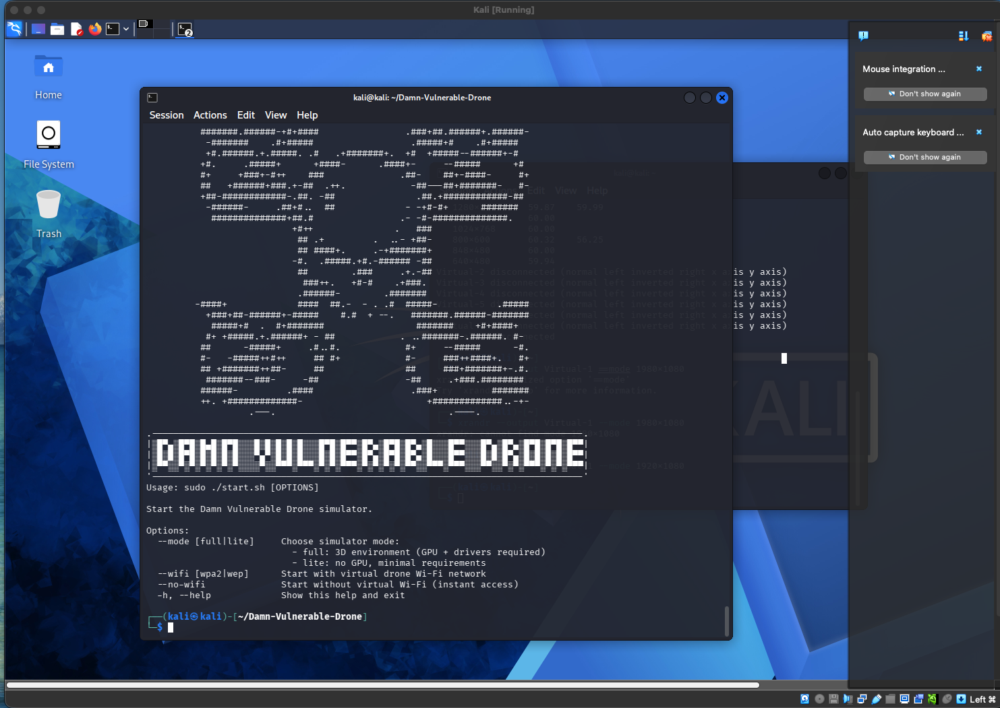
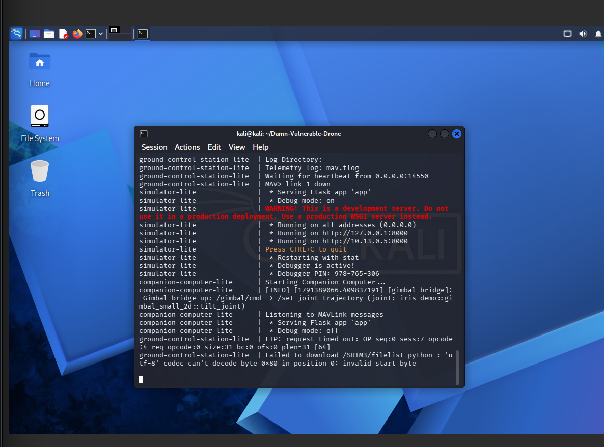
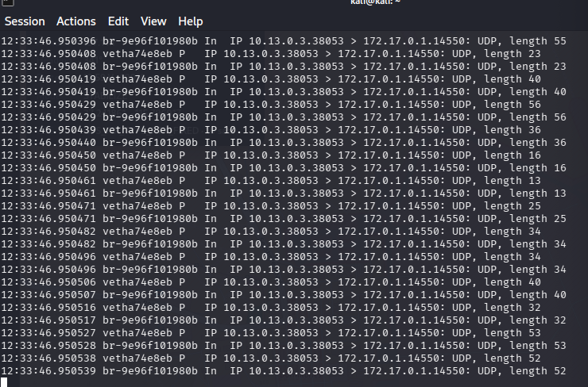
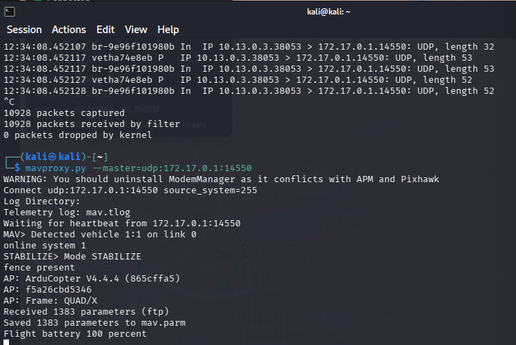
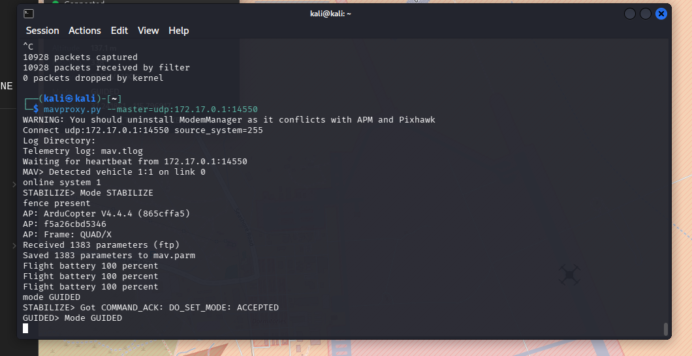

# DVD MAVLink Injection

Unauthenticated MAVLink command injection against the **Damn Vulnerable Drone (DVD)** lab: I connected to the drone's telemetry link as an uninvited ground control station and forced a flight-mode change that the autopilot accepted with no authentication. The project then goes one level deeper, pulling the autopilot firmware out of its container and reading it in Ghidra to find the missing check in the actual code, and it closes with detection and mitigation.

> **Lab only.** Every action here was performed against the Damn Vulnerable Drone simulator running locally on my own machine. Nothing here targets a real aircraft or any system I do not own. Sending MAVLink commands to drones you do not operate is illegal.

**Credit:** Performed against the [Damn Vulnerable Drone](https://github.com/nicholasaleks/Damn-Vulnerable-Drone) lab by Nicholas Aleks, used under the MIT License. DVD provides the intentionally vulnerable target; the recon narrative, firmware analysis, detection, and mitigation in this repository are my own work.

---

## Target environment

| | |
|---|---|
| Lab | Damn Vulnerable Drone (lite mode) |
| Autopilot | ArduCopter V4.4.4 (build 865cffa5), SITL |
| Attacker | Kali Linux, same host, pymavlink / MAVProxy |
| Telemetry | MAVLink over UDP, port 14550 |



The lab stack running, with the autopilot, companion computer, ground station, and simulator each on their own container address:



---

## DVD scenario mapping

The DVD wiki organizes its targets into attack scenarios by category. This project maps to three of them. I reference the scenarios by name; the write-up below is my own and does not reproduce the wiki walkthroughs.

| DVD scenario | Category | What I did |
|---|---|---|
| MAVLink Injection Attack | Injection | Connected as an unauthenticated GCS and injected a `COMMAND_LONG` the autopilot executed. |
| Flight Mode Injection | Injection | The concrete version: a `MAV_CMD_DO_SET_MODE` injection that forced STABILIZE to GUIDED, confirmed by `COMMAND_ACK: ACCEPTED`. |
| Firmware Decompile | Firmware Attacks | Copied the ArduCopter binary out of its container and reversed `handle_command_long` in Ghidra to locate the missing authentication check. |

---

## The vulnerability

MAVLink v1, and MAVLink v2 without message signing, carries no authentication. The autopilot never checks who sent a command. Any host that can reach the telemetry stream and frame a valid message gets it executed. No credentials, no key, no CVE, and no zero-day are required: network reach to the MAVLink link is the whole precondition.

At risk once an attacker has that reach: flight mode and arm state, the mission route and waypoints, GPS position, and the aircraft itself.

---

## How I found the endpoint (the troubleshooting story)

The injection was simple once I could reach the stream. Reaching it was the real work, and it is the part most write-ups skip.

**1. Loopback was a dead end.** My first attempts pointed MAVProxy at `127.0.0.1:14550` and timed out. `ss -lunp` showed nothing listening on loopback, and binding a container IP failed with `Errno 99: Cannot assign requested address`. UDP binds locally but sends to a target, so I could not bind an address that was not on my host, and the telemetry had never touched loopback in the first place.

**2. Map the Docker network.** `docker ps` and `docker inspect` showed the stack sitting on a Docker bridge with the flight controller, companion computer, ground control station, and simulator each on their own address. Only the web ports were published to the host, not 14550.

**3. tcpdump ended the guessing.** `tcpdump -i lo udp port 14550` captured zero packets. Switching to `tcpdump -i any udp port 14550` immediately revealed the real flow: the autopilot at `10.13.0.3` was streaming MAVLink to the Docker gateway `172.17.0.1:14550`, an address that lives on the host.





**4. Link up.** Pointing MAVProxy at `udp:172.17.0.1:14550`, the address the drone was actually sending to, produced an instant link: ArduCopter V4.4.4, QUAD/X frame, 1383 parameters, battery 100 percent. A full telemetry link, with no credentials at any point.

---

## The attack

With a live link, I injected a `COMMAND_LONG` carrying `MAV_CMD_DO_SET_MODE` from an uninvited ground station. The autopilot accepted it and switched flight mode from STABILIZE to GUIDED, confirmed by the command acknowledgement. An arm command was accepted on the same unauthenticated link.

```
STABILIZE> mode GUIDED
Got COMMAND_ACK: DO_SET_MODE: ACCEPTED
GUIDED> Mode GUIDED
```



The proof of concept is [`scripts/inject_mode.py`](scripts/inject_mode.py). It connects to the endpoint, waits for one heartbeat to learn the target system and component IDs, resolves the numeric mode id for the airframe, sends the mode-change command, and reads back the `COMMAND_ACK`.

---

## Firmware: why the autopilot allowed it

To find the root cause in code rather than on the wire, I copied the ArduCopter binary out of its container and triaged it.

- `file` reported an ELF 64-bit x86-64 binary, not stripped. That is the SITL build for the host, not an ARM Pixhawk image, and the intact symbols made reversing straightforward.
- `strings` confirmed the same build I had just attacked, `ArduCopter V4.4.4 (865cffa5)`, along with handler names including `handle_command_long` and `MAVLink_routing`.
- Loaded into Ghidra, following the command path from `handle_command_long` into `set_mode` shows the command being read and executed, then acknowledged, with no check of the sender anywhere along the path.

Simplified representation of the decompiled handler:

```c
// handle_command_long  (simplified from the Ghidra decompilation)
switch (cmd->command) {
  case MAV_CMD_DO_SET_MODE:
    set_mode(cmd->param2);
    // no sender / authentication check above
    ack(MAV_RESULT_ACCEPTED);
    break;
}
// no signing or auth branch anywhere in the handler
```

The accept path is the only path. The firmware confirms from the code side exactly what the packet capture showed from the protocol side: there is no authentication branch to fail, so any host on the wire that frames a valid command gets it executed.

> A real Pixhawk image is different: an `.apj` is JSON with the firmware base64 and gzip encoded in its `image` field, so it has to be decoded before reversing, and it is ARM Cortex-M rather than x86-64. That path is noted here for completeness; the analysis above is of the lab's SITL binary.

---

## Detection

Detection and mitigation are my own additions on top of the lab. DVD ships the vulnerable target only; it does not include detection or hardening content, so everything in these two sections is original work.

The recon that the injection depends on is noisy, and that noise is the most reliable thing to catch. A fast `nmap` sweep sends thousands of SYNs from one source in seconds, which any rate counter can flag. The Suricata rule below flags a TCP SYN sweep from a single source. It is the rule from my project; add a `msg` field before deploying it operationally.

```
# Suricata: flag a TCP SYN port sweep from a single source
alert tcp any any -> $HOME_NET any ( \
    flags:S; threshold: type both, track by_src, count 20, seconds 5; \
    sid:1000001; )
```

Throttle the same behavior at the host with a matching rate limit. The `--update` rule below assumes a companion `--set` rule earlier in the chain that records each new source:

```
iptables -A INPUT -p tcp --syn -m recent \
    --update --seconds 5 --hitcount 20 --name scan -j DROP
```

Detecting the injection itself, rather than the recon, means watching the MAVLink link for commands from where no ground station should exist: `COMMAND_LONG` traffic to UDP 14550 from an unexpected source address, or more than one `source_system` issuing commands on a link that should carry exactly one GCS. I am not publishing a specific injection signature here, because a reliable one depends on the deployment's addressing and expected GCS set.

---

## Mitigation

The injection works because the link trusts any sender. Fixing it means authenticating the link and not trusting the wire.

- **MAVLink 2 message signing.** Enable signing so each message carries an HMAC-SHA256 tag derived from a shared per-link key. The autopilot then rejects unsigned or forged commands, which closes the injection directly.
- **Network segmentation.** Separate the flight controller, companion computer, and ground station so no unauthenticated GCS endpoint is reachable from an attacker's position on the wire.
- **Rate-limit and monitor.** Deploy the Suricata rule and the iptables throttle above so a scan is logged and dropped rather than silently succeeding.
- **Firmware hardening.** Ship stripped release builds with no hardcoded keys or credentials in the image. Sign firmware with secure boot so a tampered image will not run, and encrypt images so a dump is not readable. On real boards, enable MCU readout protection and disable JTAG and SWD so the binary cannot be pulled off the chip.

An honest caveat on the firmware side: once an attacker already has the binary, decompilation cannot be fully prevented. The win is not leaking it, keeping secrets out of it, and signing it so a modified copy will not boot.

---

## Repository layout

```
dvd-mavlink-injection/
├── README.md
├── LICENSE
├── .gitignore
├── scripts/
│   └── inject_mode.py      # mode-change proof of concept (pymavlink)
└── docs/
    ├── DVD-MAVLink-Injection-Progression.pdf   # full slide deck with every capture
    └── img/                # key screenshots used above
```

## Running the proof of concept

The script targets the lab endpoint only. Requires `pymavlink`.

```bash
pip install pymavlink
python3 scripts/inject_mode.py
```

Edit `TARGET` and `TARGET_MODE` at the top of the script if your lab exposes the stream on a different address.

---

## What the lab drives home

Unauthenticated MAVLink is a problem at both the protocol level and the firmware level. The packet capture showed the drone accepting a mode change with no credentials; the decompiled handler showed why, with no authentication branch in the code. Fixing it is the same answer from both ends: sign the messages, segment the network, and stop trusting the wire.
